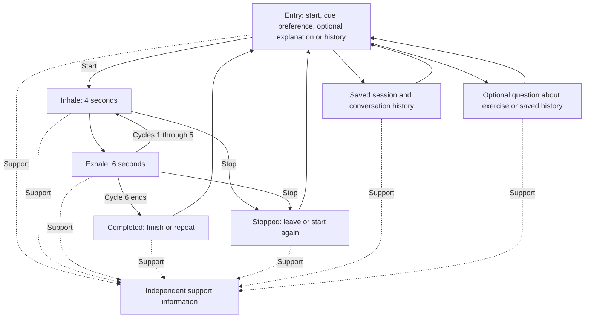

# Breathing Break — Part 3.1 design proposal

This proposal is retained as Part 3.1 history. The Part 3.2 section below records
implemented behavior and supersedes the earlier no-app status.

Status: research and design only,No running application,
database, provider connection, or clinical evaluation exists. I chose
paced breathing, the scenario below, and the circle-cue sketch direction.
Remaining behavior in this document is a proposed design for review.

## Purpose and fictional task

Alex is a fictional student with a presentation starting soon. Alex wants to take
a short breathing break without explaining feelings, filling out a questionnaire,
or navigating a skill library. The goal is to make a short skill easy to start
and leave, not to predict or demonstrate a change in Alex's mental health.

Only paced breathing is in scope: inhale for four counts and exhale for six.
The app must preserve these steps and must not introduce breath holds, change
the ratio, or generate therapeutic instructions.

## Main flow



Support is an explicit destination from every relevant state. Opening support
during breathing pauses the exercise; returning offers resume or stop. Never
automatically resume breathing. Leaving the exercise cancels scheduled cues;
restarting begins a new session. Pausing/support time is excluded from guided
duration. Detailed refresh/resume behavior remains an open implementation decision.

## Proposed screens and controls

| Screen | Content and primary action | Other user control |
| --- | --- | --- |
| Entry | “A short breathing break”; “About 1 minute · 6 cycles”; Start breathing | Circle/text cue choice; optional explanation; history; leave |
| Inhale | “Breathe in”; current count out of 4; subtle expanding circle | Stop; switch to text-only; support |
| Exhale | “Breathe out”; current count out of 6; subtle contracting circle | Stop; switch to text-only; support |
| Completed | “Session complete”; duration and cycle count | Finish or repeat; support; honest save status in implementation |
| Stopped | “Session stopped”; actual elapsed active duration | Return to start or start again; no penalty or completion pressure |
| History | Dated session rows with duration and completed/stopped status; ordered conversation messages | Return; select a record; no model needed for ordinary browsing |
| Optional explanation/question | Reviewed skill explanation and optional question input, outside the exercise | Skip, start without chatting, leave, support |
| Support | Clearly identified, independently supplied support information | Return, then explicitly resume or stop if a session was paused |

Every screen displays a coursework label and independent support access. Mockup
support content is explicitly a placeholder until verified resources are selected.
Mockup outcomes/history are fictional examples, never claims of actual saved data.

## Research source and design rationale

Source: the instructor's Assignment 3 “Research foundation” and “Study findings
and supporting evidence” table supplied by the student as screenshots. It reports
an ongoing study with 15 patients, 13 clinicians, 15 prototype evaluation sessions,
and 150 participant-task combinations. The table is the assignment's research
source; no separate dataset is required. Counts represent study observations,
not measures of clinical effectiveness or evidence that this prototype works.

| Finding | Proposed choice and reason | Alternative and accepted tradeoff |
| --- | --- | --- |
| R1: skills beyond 90–100 seconds lose attention | Six 10-second cycles give a 60-second guided sequence, matching the reported comfortable duration | A 90-second session offers more cycles; the shorter default offers less practice but less time demand |
| R2: crisis access must be frictionless | Direct, labeled support control; no chat, classifier, login, or questionnaire prerequisite | Hiding support in a menu saves space but adds navigation; accept persistent screen space |
| R3: permission to stop | Stop stays available; “You can stop whenever you want”; stopped is distinct from completed | A confirmation dialog prevents accidental stops but adds friction; propose immediate stop and an explicit restart option |
| R4: user controls the journey | Choose start, cue mode, stop, repeat, or leave; model suggestions are optional | Automatic routing reduces choices but removes control; accept a small number of explicit choices |
| D1: progressive interface contraction | Entry has optional details; exercise reduces to the current cue and essential controls; text-only is user selected | Automatic simplification based on clicks could misinterpret behavior; give up automatic adaptation and make no distress inference |
| D2: one atomic action at a time | Only the current inhale/exhale instruction is prominent; history/chat stay outside the guided sequence | A dashboard or continuous chat exposes more functions but competes with pacing; accept less simultaneous information |
| D3: minimize emotional cost | No required disclosure, mood rating, journaling, or outcome questionnaire | Mandatory check-in could supply self-reported context but adds effort; accept less emotional context |
| D4: persistently visible safety | Support remains in a stable, visible location through the exercise and failure states | Entry-only support makes the exercise cleaner but disappears at a critical moment; accept a small persistent control |
| D5: personalization without configuration burden | Optional “Remember this cue choice” and change/forget controls; start works with defaults | A profile wizard collects more preferences but delays entry; accept narrower personalization |
| D6: low-stimulus, nonjudgmental language | Restrained colors, plain wording, no streaks, grades, celebratory pressure, or obligatory motion | Strong animation and rewards attract attention but may add stimulation; accept a quieter presentation |

D1 is addressed conservatively: reducing content during a selected task is a
design interpretation, not evidence that the system detects changing distress.
Self-reports, interaction records, and model interpretations must remain distinct.

## Timing and accessibility assumptions

One count is proposed as one second. Six repetitions of (4 + 6) seconds equal
60 seconds. Measure later from the first inhale instruction to the end of the
sixth exhale, including application delays. There are no planned inter-cycle gaps
or provider calls inside this sequence. This is arithmetic, not a measured runtime
result. Entry, reading optional explanations, and choosing settings are separate;
their duration will vary. Voluntary pauses and support access are reported separately.
Never force the user to leave when the sequence ends.

The circle expands during inhale and contracts during exhale, without flashing
or decorative looping. Phase text and a numeric count communicate meaning without
color or motion. Text-only mode removes expansion/contraction while retaining
the same timing; respect the device's reduced-motion setting. Screen-reader
announcement frequency needs later testing; avoid announcing every animation frame.

Proposed accessibility targets: 16px or larger body text, at least 4.5:1 normal-text
contrast, visible keyboard focus, meaningful control labels, approximately 44px
touch targets, and a single-column layout usable at 320px width. Essential actions
must work without hover. These are design targets, not verified compliance claims.

## Proposed model role and architectural boundaries

Vue presents the interface, runs the fixed pacing cues, and calls FastAPI using
HTTP/JSON. FastAPI validates input, owns business rules and persistence, and is
the only layer that accesses SQLite or the provider. Intended database location:
`data/app.sqlite3`, resolved relative to the project. No runtime files exist yet.

The model is an optional helper outside the guided exercise. It can explain the
reviewed exercise and answer a question such as “What did I do last time?” using
permitted records. A fixed explanation is available even if the model is unavailable.
It must not diagnose, give therapy, change the skill, infer distress from clicks,
or invent history. Code controls sequence, exits, timing, saved state, and support.

Proposed SQL RAG flow, consistent with the starter:

1. FastAPI sends the question and relevant schema for a retrieval-query proposal.
2. Validate the proposed SQL as untrusted: one permitted read-only query, allowed
   tables/fields, current demo-user/conversation scope, safe parameter binding,
   read-only connection, and limits on rows, runtime, and context size.
3. Send relevant records with IDs/field meanings plus reviewed skill material in
   a second call. Stored text is data, not overriding instructions. Answer only
   from available information and acknowledge gaps.
4. Save the actual reply through a separate parameterized backend write. Return
   truthful persistence status. A failure creates no fabricated assistant reply.

Both calls count toward the later API budget. Proposed limit: at most two provider
calls per submitted question, finite timeouts, no automatic paid retries; exact
timeout and session budget need confirmation before implementation. History viewing
requires no model call. Rejected SQL, empty context, provider failure, and database
failure have distinct UI states; support and exercise entry remain available.

## Proposed saved data and personalization

| Record | Proposed fields | Purpose |
| --- | --- | --- |
| Demo user | demo_user_id | Scope fictional records; no real student identity needed |
| Conversation | conversation_id, demo_user_id, created_at | Group related messages |
| Message | message_id, conversation_id, role, content, timestamp, sequence, request_id, request_status | Reconstruct submitted messages and actual replies in order; handle retries honestly |
| Exercise session | session_id, demo_user_id, optional conversation_id, skill, started_at, ended_at, active_duration_seconds, paused_duration_seconds, cycles_completed, stopped/completed status, cue_mode, request_id | Display actual practice activity and distinguish interruption from completion |
| Preference | demo_user_id, cue_mode, remember_choice, updated_at | Optional circle/text preference; change or forget it |

Proposed relationships: one demo user has many conversations/sessions and one
preference record; one conversation has many messages and may relate to sessions.
Stable request IDs and transactional writes prevent duplicate saves later.
Store no inferred diagnosis or mood. No need to collect presentation details.

If the person opts in to remembering the cue, entry says “Using your saved
text-only cue” or equivalent and provides Change/Forget. It never locks the user
into a mode or changes exercise timing. Without opt-in, use the current visit's
choice and do not retain the preference. Session/history retention and deletion
controls need a specific policy before implementation.

History shows messages with role, order, and time, and sessions with duration/status.
Counts describe activity only. A worked fictional example: session DEMO-S1 is
completed at 60 seconds; DEMO-S2 is stopped at 20 seconds. Asked about the most
recent session, the model should cite DEMO-S2 and say it stopped after 20 seconds,
not that the student became calmer. These records are examples, not existing rows.

## Safety and failure design

Label the interface “Coursework prototype · Not therapy” and explain that no one
is monitoring it. Do not offer or deploy it as support for a real person in distress.
All walkthroughs and later tests use fictional scenarios.

Proposed handling of crisis-related input: support access is always explicit and
independent. If text handling flags possible crisis content, return a short,
pre-reviewed boundary statement and point to the same independent support route,
rather than improvising advice. Detection is supplemental and can miss content
or flag unrelated text; it must never gate support or imply assessment/monitoring.
Exact recognition rules, response wording, and region-appropriate verified
resources remain unresolved. No usable helpline information is claimed here.

Provider failure: show the failure honestly and keep static instructions/support.
Save failure: show “Not saved” and an explicit retry option; do not claim success.
Leaving: clear old timers, record stopped if saving succeeds, and never penalize.
During support: pause and preserve the user's choice to resume or stop.

## Design artifacts and remaining decisions

The original conversation sketch compared circle and text-only cue alternatives.
The student selected the circle-cue direction.

[Original Figma storyboard](https://www.figma.com/design/Ec255iH4NSnqPSmo5N6WQ6?node-id=1-391)
contains editable entry, inhale, exhale, completed, stopped, text-only, history,
and support frames. These are static design frames, not captured runtime screens
or a wired Figma prototype. The optional model screen and preference controls
are described here but are not fully drawn. Preserve the original baseline and
duplicate it before later alternatives. Instructor sharing permissions remain
unverified. The diagram above supplies the intended navigation.

Figma uses Inter instead of the conversation sketch's Arial because Arial was
not available through the connected tool. Reused Simple Design System button
instances supply neutral controls; other content is editable text and shapes.
The final screenshot was checked after repairing clipped text. This is visual
design inspection, not an accessibility or runtime test.

Questions for student review before implementation:

- Confirm the proposed 60-second duration, cue switching, and immediate-stop behavior.
- Confirm optional model explanations/history questions as the model contribution.
- Confirm preference opt-in, retention/deletion, and refresh/restart policy.
- Select and verify support resources, exact crisis-input handling, and response wording.
- Check motion comfort, contrast, text readability, keyboard order, and narrow layouts
  in the running interface later; static frames cannot establish those behaviors.

No previous travel-app code was supplied or reused. Familiar Vue/FastAPI/SQLite
architecture is carried forward as required by the course. Proposed API methods,
schemas, timeouts, and persistence details will be finalized before implementation.

## AI-use disclosure draft

Codex assisted with interpreting the assignment screenshots, proposing the initial
circle/text sketch, drafting research-to-design tradeoffs, the flow diagram,
architecture/data proposal, and submission documents. The student selected paced
breathing, the fictional presentation scenario, and the circle-cue direction.
Tools used include local file inspection/editing and the connected Figma MCP.
Exact model/version was not independently verified. No app/provider tests or
clinical tests were performed. A Figma library-metadata return exceeded the tool
limit and a later construction attempt failed to resolve imported component IDs;
those failed calls reported no committed canvas edits. Reimporting the component
set in the build call resolved that failure. The first successful layout clipped
text; restoring text auto-height fixed it, and a second screenshot was inspected.
Student review of all AI-assisted prose is pending.

## Part 3.2 — implemented local prototype, October 22, 2026

The student authorized implementation and project-local dependencies and chose
mock assistance first, with live API setup later. Work is on `codex/part-3-2`,
based on `ada0f9ba06cbcf37961db7c4daae3757a2b91eb9`. Part 3.2 is not yet committed,
pushed, or submitted. Original report.md and Figma frames are preserved.

### Responsibilities and actual flow

| File | Responsibility |
| --- | --- |
| frontend/src/App.vue | Vue views, controls, request states, preferences, history, native support dialog |
| frontend/src/breathing.js | Fixed 4/6 phases, monotonic timing, pause/resume, interruption checks |
| frontend/src/api.js | JSON requests, finite timeouts, honest failed/unconfirmed states |
| frontend/src/content.js | Static U.S. support information verified through the hotline connector |
| backend/main.py | Small FastAPI routes and request orchestration |
| backend/models.py | Typed inputs/outputs, UUIDs, enums, lengths, finite durations |
| backend/database.py | SQLite models/relationships, parameterized writes, transactions, idempotency |
| backend/retrieval.py | Read-only scoped SQL execution with authorizer and limits |
| backend/provider.py | Mock and separately configured live provider, reviewed skill context, response checks |
| backend/config.py | Explicit backend/.env loading and project-relative database path |
| backend/inspect_db.py | Read-only schema/row inspection |
| backend/verify_records.py | Compare API records with SQLite without modifying either |

Vue sends HTTP/JSON to FastAPI. Only Python accesses SQLite or the provider.
The built frontend is served locally on port 8000. Vite development uses port
5173 with an /api proxy. This is a single-fictional-user, single-tab demo with
no authentication or multi-user service claim. No records are seeded at startup.

### API contracts

Common failures: 422 invalid input, 404 missing record, 409 stale version/invalid
transition/changed payload with reused ID/question budget, 503 database operation
failed. Generated schemas are available at /docs. Health never returns secrets.

| Method/path | Input | Output and important behavior |
| --- | --- | --- |
| GET /api/health | none | status, model_mode, provider_configured boolean; live_verified is true only after a live reply is saved during this server run; configuration alone is not verification |
| POST /api/sessions | request_id UUID, cue_mode circle/text | Active session persisted before cues start; identical request replay returns original; changed payload 409 |
| GET /api/sessions | none | Latest 100 sessions: IDs, times, status, active/paused/browser durations, cycles, cue, version, stop reason |
| POST /api/sessions/{id}/events | request_id UUID, action pause/resume/stop/complete, expected_version, reason, optional observed_seconds | Transactional state transition; identical event replay returns saved result; stale version 409 |
| GET /api/preferences | none | cue_mode and remember; circle/false default if absent |
| PUT /api/preferences | cue_mode, remember boolean | Save optional preference or forget it; failure shown as not saved |
| POST /api/conversations | request_id UUID | Stable conversation ID and time; retry returns same conversation |
| GET /api/conversations | none | Latest 100 conversation IDs/times |
| GET /api/conversations/{id}/messages | none | Up to 200 ordered messages, including role/content/time/status/provider mode/supporting IDs |
| POST /api/conversations/{id}/messages | request_id UUID, content 1–1000 characters, simulate_failure boolean default false | Request status, messages, error, query and retrieved records; provider failure preserves failed user message without a fabricated reply; failure simulation only in mock mode |
| GET /api/conversations/{id}/requests/{request_id} | none | Check persistence/status after uncertain network response; wrong conversation 404 |

Worked example: start request A creates session S, version 1. Stop event E saves
stopped S at version 2. Replaying E returns its saved result without another row.
Completing a stopped session is rejected. Actual IDs are UUIDs, not these letters.

### Timing, leaving, and save failures

The browser uses performance.now() and phase calculations from elapsed time rather
than counting interval callbacks. Six cycles take 60 seconds. A callback gap over
two seconds is treated as interrupted guidance and stops the exercise. Hidden
pages pause; returning requires Resume. Pause time is excluded. Completion needs
both server active time and browser measurement within 60–90 seconds. No provider
call occurs during guidance, and the completed screen does not force an exit.

The real walkthrough measured 60.0138 browser-guided seconds and 60.1077 server
seconds, including HTTP overhead. Entry/setup time was separate and not measured.
Support opens immediately and pauses locally, saving a pause event. Returning
never auto-resumes. Failed saves freeze pacing and display unconfirmed status;
Retry reuses the same event ID instead of duplicating a write.

In-app navigation stops/saves before leaving. Refresh/close warns during an
unfinished exercise. If the tab is nevertheless left, the next visit marks the
persisted unfinished session stopped with reason refresh. Its server interval may
include time after closure; observed_seconds is null and the UI explains that it
is not measured guided time. There is no reliable instant save on abrupt closure.
Multiple-tab coordination is not implemented; use one tab for this demo.

### Model, RAG, and data boundaries

The mock helper is labeled in the interface, messages, and health. It uses real
SQL retrieval but scripted planning/answer generation, not a live LLM. Live mode
is separately configured for the OpenAI Responses API with store=false, 700 maximum
output tokens, 20-second default per-call timeout (capped at 30), no automatic
retries, at most two calls per question, and ten questions per conversation by
default. A new conversation starts a new budget. No paid call was made or agreed
to in this task, and no live model behavior has been verified.

The planner receives a question and allowed view schema. Proposed SQL is untrusted.
The executor uses SQLite URI mode=ro, scoped TEMP views, PRAGMA query_only, an
authorizer permitting SELECT/read-through-views/a small function allowlist, a
100ms progress deadline, at most 20 rows, 12,000 context characters, and 1,000
characters per text field. Direct base/system tables, writes, multiple statements,
and extension loading are denied. Views scope sessions to the fictional demo user
and messages to the current conversation. Writes use separate parameterized code.

The answer receives records with IDs and reviewed skill information. JSON format,
answer size, and supporting IDs are checked. Prompts prohibit changed skill steps,
diagnosis, invented history/improvement, and therapeutic advice. Prompt/format
checks cannot guarantee every semantic claim is grounded; live output still needs
fictional evaluation. A provider failure never creates a fabricated reply.

Tables: sessions, session_events, preferences, conversations, requests, messages.
Foreign keys link events to sessions and messages/requests to conversations.
Sessions can start without chat. Request IDs and unique (request_id,role) message
pairs prevent duplicates. Submitted questions are saved first; actual replies and
request success share a transaction. Failed writes roll back success. Restart
marks pending provider requests failed. Preferences need opt-in and can be forgotten.
History is activity only. Runtime records are local and ignored by Git. Automatic
retention/deletion and account controls are not implemented; use fictional input.

### Safety, accessibility, and design changes

Support uses static U.S. resource details verified with the hotline connector on
October 22, 2026. It opens without API calls from a sticky header. No phone, text,
or chat link was activated in testing. A supplemental suicide/self-harm phrase
match returns a fixed boundary response without provider calls. It can miss or
misclassify text, is not an assessment, and never gates support access.

The support header became sticky after browser focus scrolling revealed it could
move out of view. At 320px, extra introduction content hides during guidance so
Stop stays visible. Reduced-motion devices use text cues. Keyboard focus and
native modal/escape behavior were checked; full screen-reader and accessibility
audits were not performed. The circle/text direction and original Figma frames
are preserved. No deployment, real-person distress testing, or clinical claims.

### Sources and AI assistance

Official references consulted: [Vue quick start](https://vuejs.org/guide/quick-start.html),
[FastAPI testing](https://fastapi.tiangolo.com/tutorial/testing/), and
[OpenAI text generation](https://developers.openai.com/api/docs/guides/text).
The OpenAI Docs skill guided the provider adapter. Codex assisted with implementation,
tests, browser/database inspection, and this documentation. The student approved
dependencies and mock-first work. Sandbox socket/temp/symlink restrictions required
normal host permissions. An unclear offline-proxy error and support positioning
were corrected from browser evidence. No clinical testing or new Figma editing.

### Final Part 3.2 live verification

This section supersedes the earlier mock-only and unpublished checkpoint status.
The student entered a key locally, authorized live verification, and approved a
maximum of four provider API attempts total. The key was never printed and remains
in ignored backend/.env. The local model is gpt-5.4-mini; example configuration
continues to default to mock so fresh checkouts do not make unrequested paid calls.

One generation request returned HTTP 400 before producing output. A read-only
model-access check confirmed access. The response format was changed from legacy
json_object mode to strict json_schema for retrieval_plan and skill_answer, following
[OpenAI structured output guidance](https://developers.openai.com/api/docs/guides/structured-outputs).
The corrected planning and answer calls both succeeded. Total: three generation
attempts (one rejected, two successful) and one non-generation model-access check.
There was no automatic retry and no further provider call.

Successful request af4f6a8e-1602-441f-9352-3a70c65682d0 in conversation
57fc339b-7644-4fdd-8cef-28cdfe33de0f used this actual model-generated query:

```sql
SELECT id, active_seconds, status FROM session_history
WHERE status = 'completed' ORDER BY started_at DESC LIMIT 1
```

The retrieved record was 9c6fc7e0-e900-4f05-ab77-f77e07fd076a, status completed,
active_seconds 60.107707500457764. The real reply, saved as message
792a4540-9672-4e2d-913a-8cf8204581c3 at 2026-10-22T18:36:32.742339+00:00,
reported exactly that duration/status and cited the same ID. No feeling or
clinical improvement was inferred. SQLite, API, and the visible browser agreed.
The prior rejected question remains failed with no fabricated reply.

Health now distinguishes configuration from a live answer saved successfully
in the current server run; this evidence flag resets on restart. The helper shows
that distinction. Additional tests validate strict-schema request construction,
sanitized HTTP errors, and the successful-save health flag without paid calls.
There are now 18 passing backend tests and 7 passing frontend tests. Historical
15-test and mock-only notes above describe the earlier implementation stage.

The outcome screen now reports this visit's entry/setup time separately from
active guidance. Timing begins at entry initialization and ends when pacing starts;
user-paced setup varies. Initial history/recovery must finish before Start is
enabled, so it cannot mark a newly started session as an earlier interruption.
